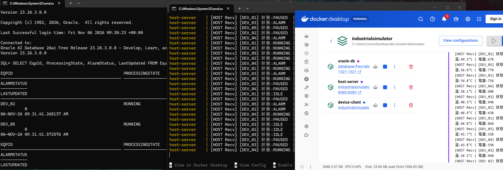
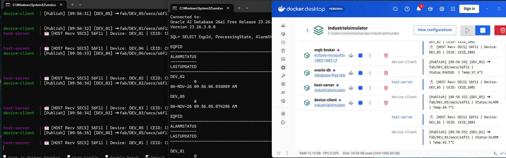

# IndustrialSimulator - 網路隔離與 SECS/GEM over MQTT 通訊系統模擬

本專案提供一個多容器編排的微服務模擬系統，實作自動化環境中，控制主機（Host Server）與機台設備（Device Client）在 OT/IT 雙網段隔離拓撲下，透過 **Raw TCP** 及 **MQTT 傳送 SECS/GEM 報文** 並自動寫入 **Oracle 資料庫** 的完整運作流程。

---

## 系統架構與網路拓撲

系統透過 Docker Compose 建立兩個獨立的 Bridge 網段，並強制指派靜態 IPv4 位址，擬真廠區雙網卡（Dual-NIC）主機與邊緣設備的實體網路區隔。

<pre>
【資料庫專用網段 db-net: 172.20.0.0/16 (IT Zone)】
 ├── Oracle DB 23c      (172.20.0.2:1521)
 ├── Host Server (NIC 1) (172.20.0.3)
 └── MQTT Broker        (172.20.0.10:1883)

【廠務設備通訊網段 device-net: 172.21.0.0/16 (OT Zone)】
 ├── Host Server (NIC 2) (172.21.0.2)  [跨網段控制閘道]
 ├── Device Client      (172.21.0.3)  [模擬 DEV_01 ~ DEV_05 機台]
 └── MQTT Broker        (172.21.0.10:1883)
</pre>

### 網路配置對照

| 服務名稱 | 所在網段 | 靜態 IPv4 | 角色與功能 |
| :--- | :--- | :--- | :--- |
| <b>Host Server</b> | <code>db-net</code> / <code>device-net</code> | <code>172.20.0.3</code> / <code>172.21.0.2</code> | 雙網卡閘道，處理訊息轉接與資料庫寫入 |
| <b>Device Client</b> | <code>device-net</code> | <code>172.21.0.3</code> | 模擬 5 台並行設備之 Telemetry 報文發送 |
| <b>MQTT Broker</b> | <code>db-net</code> / <code>device-net</code> | <code>172.20.0.10</code> / <code>172.21.0.10</code> | Eclipse Mosquitto 訊息代理中樞 |
| <b>Oracle DB</b> | <code>db-net</code> | <code>172.20.0.2</code> | Oracle Database 23c 核心資料庫 |

---

## 核心技術與設計特點

* <b>OT/IT 雙網段實體區隔</b><br>
  劃分獨立子網段。設備端（<code>device-net</code>）無法直接存取資料庫網段（<code>db-net</code>），所有設備數據一律經由 Host Server 之跨網卡介面進行轉接與校驗。

* <b>SECS/GEM over MQTT 報文解耦</b><br>
  將 SEMI E30 SECS/GEM 標準報文（Stream / Function / CEID）結構化封裝為 JSON 格式。設備端發布至 <code>fab/{DeviceId}/secs/s6f11</code>，主機端訂閱 <code>fab/+/secs/#</code> 實行高解耦 Pub/Sub 架構。

* <b>高韌性連線與流量控管</b><br>
  通訊模組內建<b>指數退避重連（Exponential Backoff）</b>機制（1s 至 16s 遞增），並於設備端發送週期加入 <b>Traffic Jitter（2.5s ~ 4.0s 動態抖動）</b>，防止斷線重連爆發 SYN 封包海與瞬時流量 Peaks。

* <b>動態 Schema 初始化與 Dapper ORM 整合</b><br>
  Host Server 具備 <code>InitDatabaseWithRetryAsync</code> 冷啟動容錯機制，自動處置 Oracle 啟動延遲與 <code>ORA-00942</code> 錯誤；資料寫入採用 SQL <code>MERGE</code> 與 <code>INSERT</code> 處理實時狀態更新與歷史 Log 紀錄。

---

## 運行測試與實測結果

### 1. Raw TCP Socket 直連通訊模式
在 Raw TCP 通訊架構下，5 台測試設備建立 Socket 連線，Host Server 接收 Telemetry 狀態數據後，由 Dapper 寫入 Oracle DB 之 <code>EquipmentState</code> 表格。

<p align="center">
  
</p>

### 2. SECS/GEM over MQTT 報文解耦模式
在 MQTT 微服務架構下，設備端發布 S6F11 封包至 <code>mqtt-broker</code>，Host Server 解析主題訊息並寫入 Oracle 資料庫，驗證雙網段解耦與狀態持久化功能。

<p align="center">
  
</p>

---

## 技術棧

* <b>開發語言與框架</b>：C# (.NET 8.0)
* <b>容器編排</b>：Docker / Docker Compose
* <b>訊息中樞</b>：Eclipse Mosquitto (MQTT)
* <b>資料庫與 ORM</b>：Oracle Database 23c Free / Dapper ORM
* <b>主要引用套件</b>：<code>MQTTnet</code>, <code>Oracle.ManagedDataAccess.Core</code>

---

## 部署與啟動指南

### 前置需求
已安裝 Docker Desktop 並且支援 Compose v2 執行環境。

### 步驟 1：啟動容器群
在專案根目錄下執行編譯與啟動：
```bash
docker compose up --build

步驟 2：驗證資料庫資料寫入
開啟另一終端機進入 Oracle 資料庫容器：
docker exec -it oracle-db sqlplus system/YourPassword123@FREEPDB1

執行 SQL 查詢驗證實時寫入結果：
SELECT EqpId, ProcessingState, AlarmStatus, LastUpdated FROM EquipmentState;
